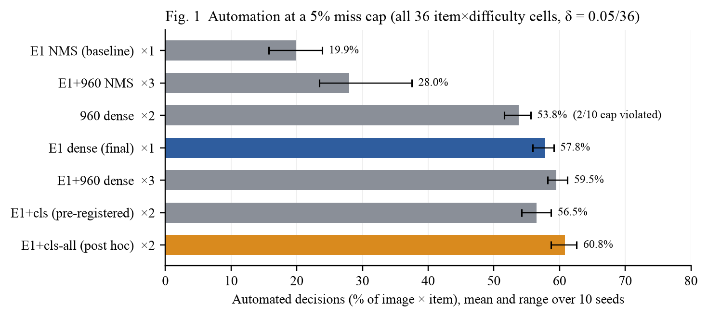
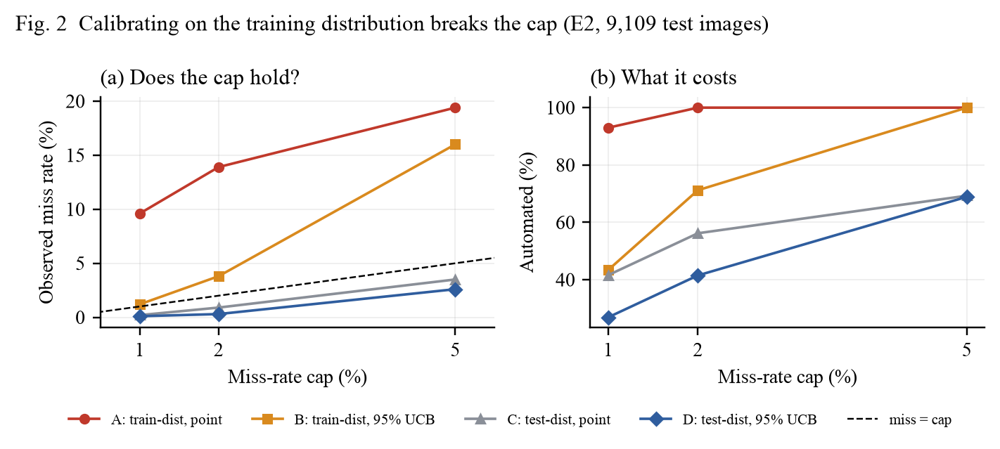
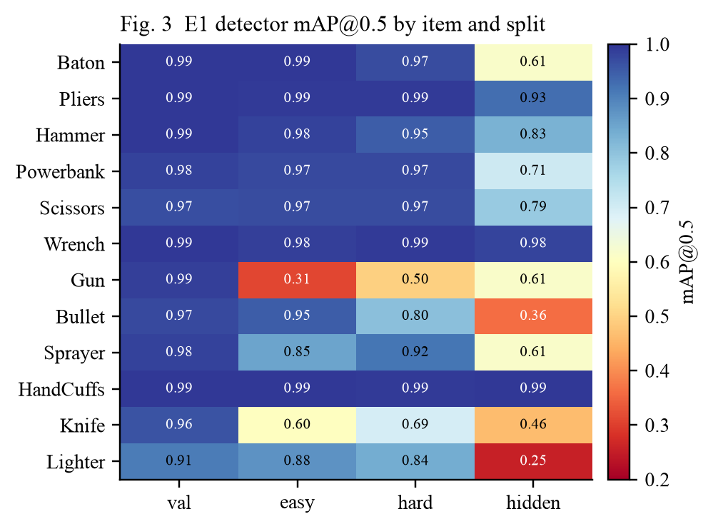
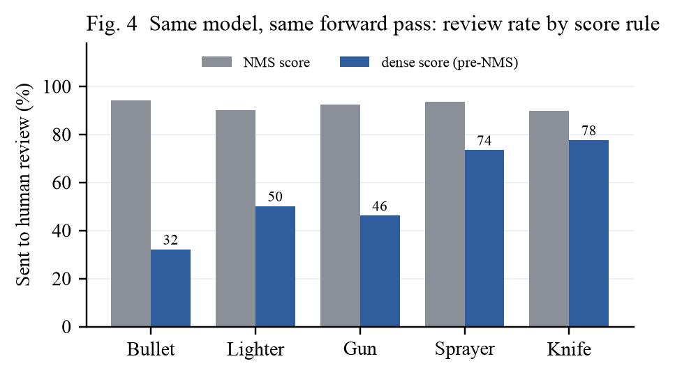
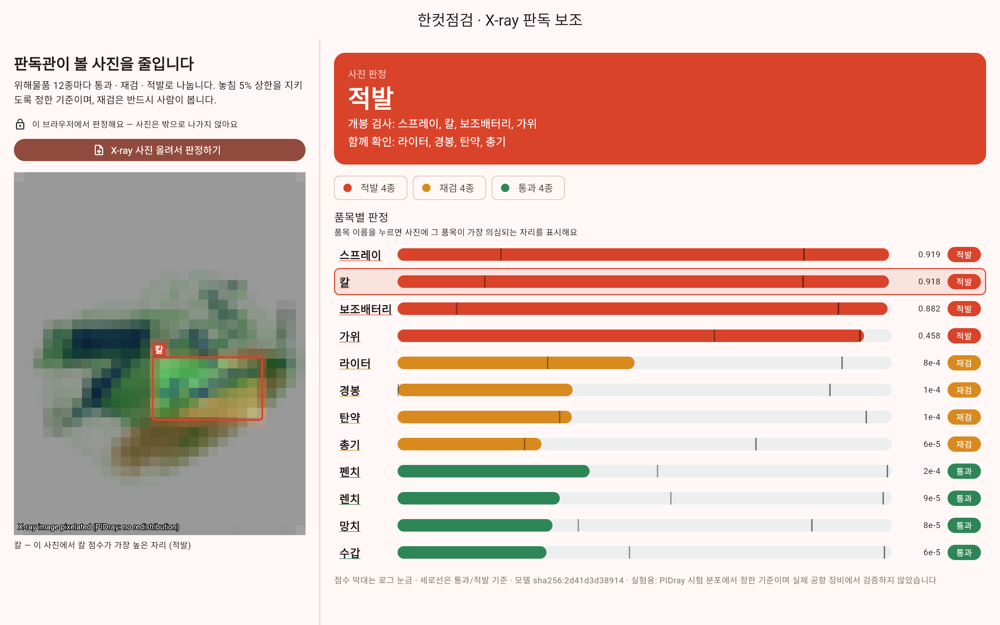
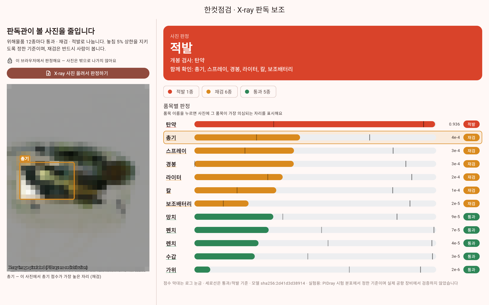
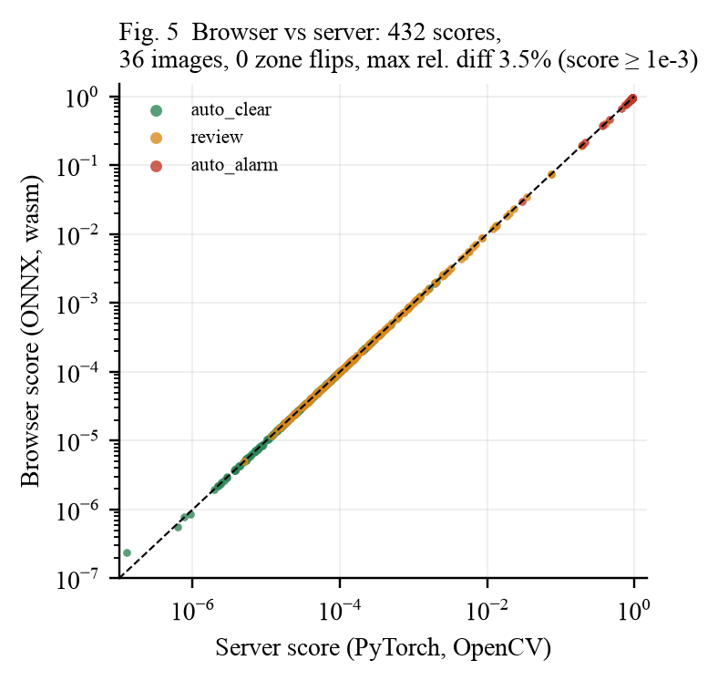

# Hancut Inspection (한컷점검)

**Live demo: https://hancut-inspection.vercel.app** · [한국어 본문](#한국어)

> How many X-ray security-screening decisions can an AI take off the screener **while a miss-rate cap still holds for every item and every concealment level?**

Each bag image × each of 12 prohibited items (PIDray) is sorted into one of three zones:
**auto-clear** (no human needed), **review** (a screener must look), **auto-alarm** (open the bag).
Thresholds are calibrated so that the miss rate stays under a cap (5%) in all 36 item × difficulty cells.
Solo AI capstone project.

## Result

| | |
|---|---|
| Final model | **E1**: YOLO11s fine-tuned on PIDray (640 px), SHA-256 `2d41d3d3…5622754` |
| Score rule | **dense**: per item, max class probability over the 8,400 anchors *before* NMS |
| Calibration | **F**: one threshold pair per item, 95% upper confidence bound on miss rate, holding in easy / hard / hidden at once, Bonferroni δ = 0.05/36 |
| **Automated at a 5% miss cap** | **57.8%** of image × item decisions (range 55.9–59.1, 10 random calibration/evaluation splits), cap violated in **0/10** splits |
| Observed miss / false alarm (seed 0) | 27 / 11,136 positives (0.24%) · 1,182 / 98,172 negatives (1.20%) |



*Fig. 1.* Automation at a 5% miss cap for every approach we tried (×N = inference cost relative to E1).
Changing only the score rule (NMS → dense, same weights, same forward pass) gave the largest gain: 19.9% → 57.8%.
Ensembles and a second classifier added at most +1.7 to +3.0 pp at 2–3× cost. The best of these (E1+cls-all, orange) was picked *after* seeing the results on an already re-used test set, so we report it as exploratory and do not adopt it.



*Fig. 2.* Calibrating on the training distribution (A, B) exceeds the cap by up to 4× once deployed on the test distribution. Calibrating on test-like images with an upper confidence bound (D) holds the cap at every level.

<p>


</p>

*Fig. 3.* Validation mAP@0.5 (0.978) overstates field performance. Hidden items fall to 0.25 (lighter) to 0.46 (knife).
*Fig. 4.* NMS throws away the scores of items that lose to a neighbouring class. Keeping them (dense) gives every item a usable threshold.

**Table 1.** Seed-0 evaluation half: 9,109 images × 12 items = 109,308 decisions (11,136 positive, 98,172 negative).

| Score | Cap | Missed (of 11,136) | False alarm (of 98,172) | Review (of 109,308) | **Automated** |
|---|---:|---:|---:|---:|---:|
| NMS | 5% | 9 (0.08%) | 1,193 (1.22%) | 91,880 (84.06%) | 15.94% |
| **dense** | **5%** | 27 (0.24%) | 1,182 (1.20%) | 46,910 (42.92%) | **57.08%** |
| NMS | 2% | 0 | 1,675 (1.71%) | 97,751 (89.43%) | 10.57% |
| dense | 2% | 0 | 1,828 (1.86%) | 97,589 (89.28%) | 10.72% |
| dense | 1% | 0 | 1,893 (1.93%) | 97,516 (89.21%) | 10.79% |

At 2% and 1% the hidden cells (100–260 positives) are too small to *certify* the cap with Bonferroni, so almost everything goes to review. More data is needed, not a better model.
At the bag level (any item alarmed → open the bag), no bag containing a prohibited item was auto-cleared, and about 90% were alarmed directly.

## Demo app

The web app runs the E1 detector **inside the browser** (ONNX + onnxruntime-web, wasm). The photo never leaves the device.
Upload an X-ray image and you get the bag verdict and 12 per-item zones. **Tap an item name to see where in the photo that item scores highest.**

<p>


</p>

*Screenshots from the live site. Left: knife highlighted (auto-alarm). Right: gun highlighted (review). The X-ray photos are pixelated because PIDray may not be redistributed; the boxes are the app's real output.*



*Fig. 5.* Browser and server agree. Over 36 PIDray test images × 12 items, **0 zone flips**, max relative score difference 3.5% (scores ≥ 1e-3), boxes within 0.2 px, about 0.4 s per image.
To get there, the browser reproduces Ultralytics letterboxing and OpenCV 5.1's two-pass bilinear resize exactly.

Run it yourself: see [app/README.md](app/README.md) (browser build, Vercel deploy, or a local FastAPI server).
Regenerate the figures with `python ml/scripts/make_figures.py` (numbers in `docs/figures/data/`, transcribed from [docs/results.md](docs/results.md)).

## Limitations

- **No untouched holdout.** PIDray's test set was reused across many experiments, so every number above is an exploratory estimate on PIDray, not a guarantee.
- **Not validated on real airport equipment.** Thresholds come from the PIDray test distribution.
- **Empty bags are not measured.** All PIDray images contain a prohibited item, so we cannot measure how often clean bags would be opened.
- **The highlighted box is not a detection.** It is the anchor with the highest score for that item, so on an auto-cleared item it usually points at nothing.
- **Weights and images are not in this repo.** PIDray is for academic use only and may not be redistributed. The demo site serves the ONNX weights for a temporary demo.

## Repository

| Path | What | Stack |
|---|---|---|
| `ml/` | data prep, zone calibration, experiments (E1–E5), figures | Python 3.11, Ultralytics |
| `server/` | inspection API (`POST /v2/inspections`) | FastAPI |
| `app/` | screener app, browser inference | Flutter web, onnxruntime-web |
| `docs/` | plan, protocol, [results](docs/results.md), [decisions](docs/decisions.md) | — |

---

# 한국어

## 한컷점검 (hancut-inspection)

**배포: https://hancut-inspection.vercel.app** (브라우저 안 판정, 임시 시연용)

> 보안검색 X-ray 사진을 **놓침률 상한 아래에서 자동통과 / 재검 / 자동적발** 세 구간으로 나눠,
> 판독관이 직접 봐야 할 사진을 몇 %까지 줄일 수 있는지 정한다.

보안검색 판독 업무의 AI 전환. AI 캡스톤디자인 1인 프로젝트.

**2026-09-24 범위 전환(#12), 2026-09-27 정리(D11).** 소방시설·소화기에서 X-ray 보안검색으로 옮겼습니다.
학교 AWS 계정이 `us-east-1` 고정이라 AI Hub 데이터를 쓸 수 없고, Weqaa는 라벨 한계가 남았습니다.
근거는 [D9·D11](docs/decisions.md)에 있고, 이전 주제 문서는 git 기록에 남아 있습니다.

## 무엇이 기여인가

탐지도 분류도 포화 영역입니다. **새 탐지기를 만들지 않습니다.** 사전학습 검출기를 씁니다.
비어 있는 건 **"놓침률을 묶었을 때 얼마나 자동화되는가"** 이고, 여기에 PIDray만 줄 수 있는 두 축이 붙습니다.

1. 놓침률을 5% / 1% / 0.5%로 묶으면 각각 몇 %를 자동 처리할 수 있는가
2. **장비가 바뀌면 임계값을 다시 잡아야 하는가** — 장비 3종
3. **고의로 숨긴 물건에서 운영점이 무너지는가** — easy / hard / hidden

**정답이 전부 데이터 안에 있습니다.** 놓침률도 자동 처리율도 PIDray 라벨만으로 계산됩니다.
사람의 응답이 필요 없고, 인간 판독관 80~90%(EU JRC)는 인용하는 비교 좌표일 뿐입니다.

## 구조

| 경로 | 역할 | 스택 |
|------|------|------|
| `ml/` | 데이터 준비, 판정 구간·임계값 탐색, 실험 | Python 3.11 |
| `server/` | 판정 API | FastAPI · Docker |
| `app/` | 판독 보조 앱 — 판정 확인·정정 | Flutter |
| `docs/` | 실행 계획, 실험 설계, 데이터, 백로그 | — |

## 빠른 시작

```bash
cd ml && pip install -r requirements.txt && pytest
cd server && pip install -r requirements.txt && pytest
uvicorn app.main:app --reload            # http://localhost:8000/health
cd app && flutter pub get && flutter test
```

## 핵심 설계

- **예측기 단독 성능(mAP)은 결론이 아니다.** 주 지표는 **놓침률 상한 하의 자동 처리율**이다.
- **판정 3구간이 중심이다.** `ml/hancut/eval/zones.py` — E2·E3·E4·E5가 전부 여기를 쓴다.
- **품목 단위로 본다.** 받을 수 있는 47,677장은 전부 양성이라, 품목 c를 포함한 가방이 양성,
  포함하지 않은 가방이 음성이다. 12종이면 이진 문제 12개다.
- **LLM에는 사진을 주지 않는다.** 판정은 비전 모델이, LLM은 구조화된 판정 결과만 받는다.
- **규정 수치를 단정하지 않는다.** TSA/ECAC의 요구 수치는 비공개다. 상한을 파라미터로 두고 스윕한다.


## 데이터 주의

**PIDray만 씁니다.** `pidray.zip` 11GB, Google Drive에서 로그인 없이 받아집니다(확인 완료).
SIXray는 비Baidu 미러가 요금 미납으로 정지돼 **받을 방법이 없습니다**.
**학술 목적 한정, 재배포 금지**이며 국외 반출 조항은 없어 `us-east-1`에서 무관합니다. 원본·전처리 이미지·모델 파일은 `data/`, `models/`에 두고
**저장소에 올리지 않습니다**(`.gitignore`). 조건은 [데이터](docs/data.md) 참고.

## 문서

| 문서 | 내용 |
|------|------|
| [실행 계획](docs/plan.md) | 12주 로드맵 (1인), 실험 E1–E6 |
| [실험 설계](docs/experiments.md) | 질문·방법·지표 |
| [실험 수행 규칙](docs/experiment-protocol.md) | 한 번에 하나만 바꾸기, 결과 기록 형식 |
| [결정 기록](docs/decisions.md) | 왜 그렇게 했는지 — D1~D11 |
| [데이터](docs/data.md) | 출처·이용 조건·받은 뒤 확인할 것 |
| [개발 환경](docs/setup.md) | 설치·실행·테스트 |
| [백로그](docs/backlog.md) | 이슈 연결 |
| [진행 기록](docs/progress.md) | 주차별 한 줄 |
| [작업 방식](CONTRIBUTING.md) | 이슈 → 브랜치 → PR, 커밋 규칙 |
| [리뷰 가이드](AGENTS.md) | PR에서 확인할 것 |
